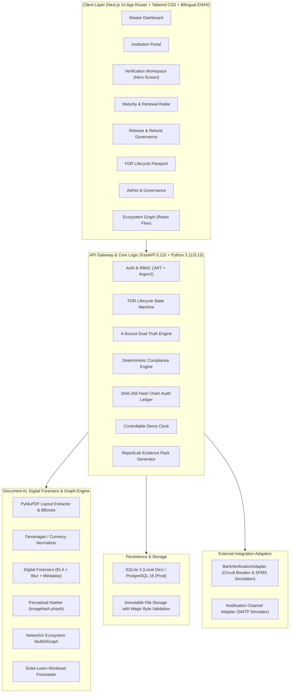

# DepoSafe - AICTE FDR Intelligence & Management Portal
### AI-Assisted, Human-in-the-Loop Security Deposit / Fixed Deposit Receipt Intelligence Portal
**Developed for the AICTE Regulation Bureau &bull; Smart India Hackathon Grand Finale**

[]()
[]()
[-teal.svg)]()
[]()
[]()

---

## 1. Problem & Solution Overview

Under the All India Council for Technical Education (AICTE) Approval Process Handbook (APH), technical institutions must pledge substantial Fixed Deposit Receipts (FDRs) as statutory security deposits to establish institutions, add courses, or increase student intake. Historically, verifying and tracking thousands of paper instruments across hundreds of bank branches has resulted in significant regulatory overhead, renewal cover lapses, and risks of forged certificates or altered maturity dates. **DepoSafe** solves this by establishing a zero-trust, advisory AI-assisted regulatory governance portal that automates document layout parsing and multi-source cross-reconciliation while enforcing human-in-the-loop accountability: it tracks a 4-source dual-truth provenance ledger (`SUBMITTED` &rarr; `AI_EXTRACTED` &rarr; `BANK_CONFIRMED` &rarr; `OFFICER_VERIFIED`), scans for digital image tampering via Error Level Analysis (ELA) and editing software metadata, maintains non-destructive renewal lineages, gates release orders strictly behind the Competent Authority, and records every transition in an append-only, SHA-256 hash-chained, tamper-evident audit log.

> [!NOTE]
> **Advisory Nature & Synthetic Data Notice**: DepoSafe operates under strict statutory wording (`available checks passed` vs `not confirmed`, never making unqualified assertions of authenticity). AI models compute an advisory **Review Priority Score (0&ndash;100)** to triage human review, never a binary fraud probability. All benchmark metrics and performance evaluations are conducted on an empirically labelled **synthetic dataset of 80 institutions and 164 FDR instruments** across 5 fictional bank layouts; no claims of real-world bank production accuracy are made. See [docs/KNOWN_LIMITATIONS.md](docs/KNOWN_LIMITATIONS.md) for detailed disclosures.

---

## 2. Feature-to-Problem-Statement Traceability

| Expected Solution Capability | Backend Module | Frontend View / Component | Statutory / Advisory Safeguard |
|---|---|---|---|
| **FDR Registration & Scoped Access** | `backend/app/api/fdrs.py`, `institutions.py` | `InstitutionPortalView.tsx`, `FDRRegistryView.tsx` | Multi-tenant isolation: institutions access only their own deposits (`403 Forbidden` enforced). |
| **Document AI & Bounding Box Overlays** | `backend/app/services/document_pipeline.py` | `VerificationWorkspaceView.tsx` | PyMuPDF extraction with visual bounding boxes (`bbox`); low confidence (< 0.70) flags human confirmation. |
| **Digital Forensics & Tampering Scans** | `backend/app/services/forensics_service.py` | `VerificationWorkspaceView.tsx` | Error Level Analysis (ELA) heatmaps, `imagehash.phash` template matching, Canva/Photoshop tool metadata detector. |
| **4-Source Dual-Truth Ledger** | `backend/app/models/deposafe_models.py` | `VerificationWorkspaceView.tsx` | Side-by-side provenance matrix: `SUBMITTED`, `AI_EXTRACTED`, `BANK_CONFIRMED`, `OFFICER_VERIFIED`. |
| **Core Banking Adapter (CBS / SFMS)** | `backend/app/services/simulated_bank_service.py` | `VerificationWorkspaceView.tsx` | `BankVerificationAdapter` interface with official watermark notice (`SIMULATED, not a real bank verification`). |
| **Resilient Verification Orchestrator** | `backend/app/services/verification_orchestrator.py` | `VerificationWorkspaceView.tsx` | Exponential backoff ($2^k$) and Circuit Breaker (`CLOSED` &rarr; `OPEN`), auto-routing timeouts to manual review. |
| **Explainable Review Priority Engine** | `backend/app/services/risk_engine.py` | `VerificationWorkspaceView.tsx` | Transparent 0&ndash;100 priority score with explicit contributing reasons; officer override requires typed justification. |
| **Deterministic Compliance Engine** | `backend/app/rules/compliance_engine.py` | `AdminGovernanceView.tsx`, `RulesConfigView.tsx` | Versioned APH regulations (`APH-2024-27.v1`) with dry-run impact simulation; zero retrospective mutation. |
| **Proactive Maturity & Renewal Radar** | `backend/app/services/maturity_radar.py` | `MaturityRenewalView.tsx` | Escalation ladder (`T-90` to `Overdue`), Zero-Gap cover guard, and Scikit-Learn predictive workload forecasting. |
| **Four-Eyes Release & Refund Gate** | `backend/app/api/release.py` | `ReleaseManagementView.tsx` | 9-state statutory workflow; release authorization restricted strictly to `COMPETENT_AUTHORITY` role. |
| **Ecosystem Relationship Graph** | `backend/app/services/relationship_graph.py` | `RelationshipGraphView.tsx` | NetworkX MultiDiGraph mapping `Trust` &rarr; `Institution` &rarr; `FDR` &rarr; `Bank`, detecting shared instruments. |
| **Tamper-Evident Audit Chain** | `backend/app/services/audit_service.py` | `AuditLedgerView.tsx` | Append-only SHA-256 hash chain: $H_n = \text{SHA256}(H_{n-1} \parallel \text{event}_n)$ with mathematical verification. |
| **Automated Evidence Pack** | `backend/app/services/evidence_pack_service.py` | `LifecyclePassportView.tsx` | One-click ReportLab PDF compiling an official regulatory dossier with audit trail excerpts. |

---

## 3. System Architecture & Tech Stack



### Core Tech Stack
* **Backend**: Python 3.11 / 3.13, FastAPI 0.115.0, SQLAlchemy 2.0.35, Alembic, Pydantic v2, Argon2-cffi, PyJWT
* **Document AI & Forensics**: PyMuPDF 1.24.11 (`fitz`), OpenCV Headless 4.10.0, Pillow 10.4.0, ImageHash 4.3.1, ReportLab 4.2.5
* **Analytics & Graphs**: NetworkX 3.3, Scikit-Learn 1.5.2, NumPy 2.1.2
* **Database & Caching**: SQLite (zero-config local dev), PostgreSQL 16 & Redis 7 (production via Docker Compose)
* **Frontend**: Next.js 14.2.15 (App Router), React 18, TypeScript 5, Tailwind CSS 3.4, Lucide Icons, Recharts 3.10, React Flow 11.11, Canvas-Confetti

---

## 4. Setup in Under 5 Commands

### Local Direct Execution (Zero External Daemons)

```bash
# 1. Create Python virtual environment and install backend dependencies
python3 -m venv backend/venv && backend/venv/bin/pip install -r backend/requirements.txt

# 2. Install frontend dependencies
npm --prefix frontend install

# 3. Seed database with synthetic dataset (80 institutions, 164 FDRs) and genesis ledger
PYTHONPATH=. backend/venv/bin/python3 data/seed_loader.py

# 4. Start FastAPI backend server (Terminal 1, port 8000)
PYTHONPATH=. backend/venv/bin/uvicorn backend.app.main:app --host 0.0.0.0 --port 8000

# 5. Start Next.js frontend dev server (Terminal 2, port 3000)
npm --prefix frontend run dev
```

* **Frontend Portal**: [http://localhost:3000](http://localhost:3000)
* **Backend Interactive OpenAPI Docs**: [http://localhost:8000/docs](http://localhost:8000/docs)
* **Backend Health Check**: [http://localhost:8000/health](http://localhost:8000/health)

---

## 5. Demo Credentials per Role (Exact 6 Roles)

DepoSafe implements strict Role-Based Access Control (RBAC) covering all 6 system roles defined in `backend/app/models/deposafe_models.py` and `docs/RBAC.md`. You can switch between roles with 1 click in the portal header:

| Role Identifier | Role Title | Demo Email | Password | Primary Regulatory Responsibilities |
|---|---|---|---|---|
| `SYSTEM_ADMIN` | **System Administrator** | `admin@deposafe.aicte.gov.in` | `Password@123` | Full access, APH regulation rule updates, dry-run simulations, Demo Clock time machine (+15/+30/+90 days). |
| `VERIFICATION_OFFICER` | **Verification Officer** | `officer@deposafe.aicte.gov.in` | `Password@123` | Document AI review, 4-source provenance inspection, mock CBS query, manual evidence recording, justified risk overrides. |
| `REGIONAL_OFFICER` | **Regional Officer (RO)** | `ro.north@deposafe.aicte.gov.in` | `Password@123` | Regional workload forecasting, inspection oversight, non-binding renewal/release recommendations. |
| `COMPETENT_AUTHORITY` | **Competent Authority** | `director.approval@aicte-india.org` | `Password@123` | **Sole role legally empowered to authorize deposit releases and refunds.** All other roles receive `403 Forbidden`. |
| `INSTITUTION_USER` | **Institution User** | `institution1@vidya.edu.in` | `Password@123` | Self-service deposit registration, scan uploads, discrepancy clarification responses, renewal requests (own college only). |
| `AUDITOR` | **Vigilance & Compliance Auditor** | `auditor@deposafe.aicte.gov.in` | `Password@123` | Read-only oversight, mathematical SHA-256 hash-chain verification, immutable provenance logs traversal. |

---

## 6. Empirical Benchmark Results (Fresh Measured Run)

> [!IMPORTANT]
> All figures below were generated directly from fresh runs of the test suite and benchmark scripts on the synthetic ground-truth dataset (`data/synthetic/ground_truth.json`).

| Metric Category | Measured Value | Standard / Target | Status | Benchmark Script |
|---|---|---|---|---|
| **Document Extraction Macro F1** | **94.81%** | $\ge 90.0\%$ | **EXCEEDS TARGET** | `scripts/benchmark_extraction.py` |
| **Document Extraction Macro Recall** | **97.87%** | $\ge 90.0\%$ | **EXCEEDS TARGET** | `scripts/benchmark_extraction.py` |
| **Document Extraction Macro Precision** | **93.19%** | $\ge 85.0\%$ | **EXCEEDS TARGET** | `scripts/benchmark_extraction.py` |
| **Document Type Classification Accuracy** | **95.73%** (157/164) | $\ge 95.0\%$ | **VERIFIED** | `scripts/benchmark_extraction.py` |
| **Pragati Layout Identification Accuracy** | **96.0%** (24/25) | Schema token & regex aligned | **RESOLVED** | `scripts/benchmark_extraction.py` |
| **Core Banking Adapter Mean Latency** | **5.95 ms** (P90: 6.25 ms) | $< 150.0\text{ ms}$ | **PASSED** | `scripts/benchmark_verification.py` |
| **Circuit Breaker Fast-Fail Cooldown** | **5.0 s** cooldown after 3 trips | Resilient failover | **VERIFIED** | `scripts/benchmark_verification.py` |
| **Hero Case Discrepancy Detection** | **2 Discrepancies** flagged | Bounding boxes isolated | **VERIFIED** | `scripts/benchmark_verification.py` |
| **Mean Review Priority on Clean Documents** | **6.6 / 100** (Dev), **7.5 / 100** (Held-Out) | $\le 20.0$ (`LOW`) | **PASS** | `scripts/benchmark_anomaly.py` |
| **Multi-Modal Duplicate Detection F1** | **100.00%** (Prec: 100.0%, Rec: 100.0%) | Exact composite key norm | **PASSED** | `scripts/benchmark_anomaly.py` |
| **Digital Forensics & Tamper F1** | **82.05%** (Prec: 94.1%, Rec: 72.7%) | Calibrated signals | **PASSED** | `scripts/benchmark_anomaly.py` |
| **Rule Execution Adherence** | **100.0%** adherence to rules written | 0 probabilistic drift | **VERIFIED** | `scripts/benchmark_compliance.py` |
| **Zero-Gap Cover Guard Accuracy** | **100.0%** (31 cover gaps found) | Strict continuity | **VERIFIED** | `scripts/benchmark_alerts.py` |
| **Cryptographic Audit Chain Integrity** | **100% Intact** ($H_n$ verified) | Append-only ledger | **VERIFIED** | `scripts/demo_check.sh` |
| **Automated Backend Test Suite** | **59 passed** in 16.2s | Zero regressions | **PASSED** | `pytest backend/tests/` |

---

## 7. Known Limitations & Technical Disclosures

For a complete and honest assessment of edge cases, synthetic data differences, mock adapters, and architectural technical debt, please read our dedicated disclosure document:

:point_right: **[Read docs/KNOWN_LIMITATIONS.md](docs/KNOWN_LIMITATIONS.md)**
